  

  
  
  

---

Hi, I'm Ilyass, but they call me **ESO EXE** ∞

I'm an independent developer who believes software should belong to the people who use it. I build free, open-source, local-first software that runs on your own machine, never expires, and never asks for a monthly payment.

## Selected work

| Project | What it is | Start here |
| --- | --- | --- |
| [**A.S.T.R.O AI**](https://github.com/esoexe/astro-ai) | A free C++ desktop app and terminal agent where several free AI models answer as one. No API keys. Windows, Linux, macOS and Android builds. | [Live site](https://esoexe.github.io/astro-ai/) |
| [**Falcon AI Studio**](https://github.com/esoexe/falcon-ai) | An MIT-licensed, zero-Python, zero-Docker C++20 neural 3D bridge with a Catmull-Clark sculptor. | [Live site](https://esoexe.github.io/falcon-ai/) · [v4.0.0](https://github.com/esoexe/falcon-ai/releases/tag/v4.0.0) |
| [**Homebrew tap**](https://github.com/esoexe/homebrew-tap) | One command installs A.S.T.R.O AI on macOS or Linux. | `brew install --cask esoexe/tap/astro-ai` |
| [**ESO Base**](https://github.com/esoexe/eso-base) | The independent foundation of ESO OS, built from upstream sources with no distribution packages. | [Repository](https://github.com/esoexe/eso-base) |

## Find me

- Website: [eso-exe.pages.dev](https://eso-exe.pages.dev/)
- The work is public. Read the source, open an issue, or star a repository.

Profile details are taken from public GitHub data.
