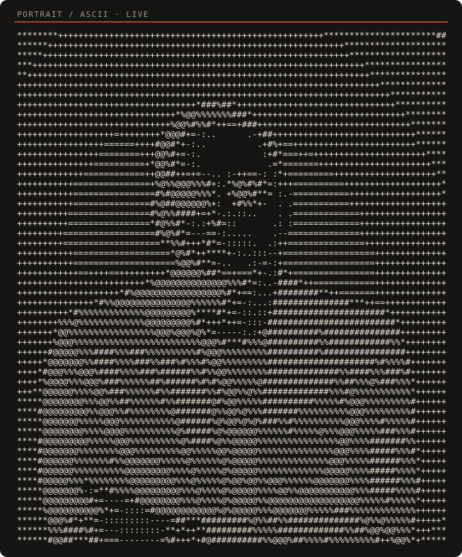

  

<table>
  <tr>
    <td width="46%" valign="top" align="center">
      
       
      <a href="https://esoexe.github.io/">Move your cursor over the interactive portrait</a>
    </td>
    <td width="54%" valign="top">

**Hi, I'm Ilyass, but they call me ESO EXE ∞**

I'm an independent developer who believes software should belong to the people who use it. I build free, open-source, local-first software that runs on your own machine, never expires, and never asks for a monthly payment.

> Freedom isn't a feature. It's the whole point.

**Website:** [eso-exe.pages.dev](https://eso-exe.pages.dev/)

    </td>
  </tr>
</table>

---

## Selected work

| Project | What it is | Start here |
| --- | --- | --- |
| [**A.S.T.R.O AI**](https://github.com/esoexe/astro-ai) | A free C++ desktop app and terminal agent where several free AI models answer as one. No API keys. Windows, Linux, macOS and Android builds. | [Live site](https://esoexe.github.io/astro-ai/) |
| [**Falcon AI Studio**](https://github.com/esoexe/falcon-ai) | An MIT-licensed, zero-Python, zero-Docker C++20 neural 3D bridge with a Catmull-Clark sculptor. | [Live site](https://esoexe.github.io/falcon-ai/) · [v4.0.0](https://github.com/esoexe/falcon-ai/releases/tag/v4.0.0) |
| [**Homebrew tap**](https://github.com/esoexe/homebrew-tap) | One command installs A.S.T.R.O AI on macOS or Linux. | `brew install --cask esoexe/tap/astro-ai` |
| [**ESO Base**](https://github.com/esoexe/eso-base) | The independent foundation of ESO OS, built from upstream sources with no distribution packages. | [Repository](https://github.com/esoexe/eso-base) |

## Find me

- Website: [eso-exe.pages.dev](https://eso-exe.pages.dev/), which refreshes its GitHub numbers every 10 minutes.
- The work is public. Read the source, open an issue, or star a repository.

The ASCII portrait and the terminal header are animated SVG images. GitHub doesn't run scripts on profiles, so the cursor-reactive version is at [esoexe.github.io](https://esoexe.github.io/).
